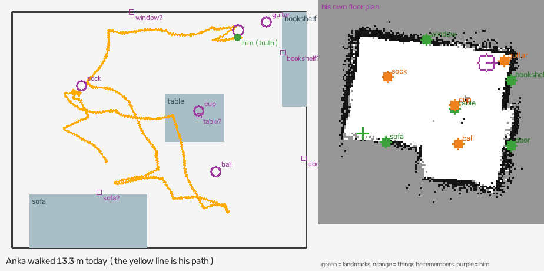
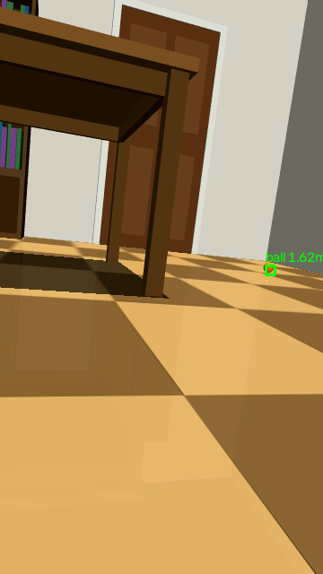
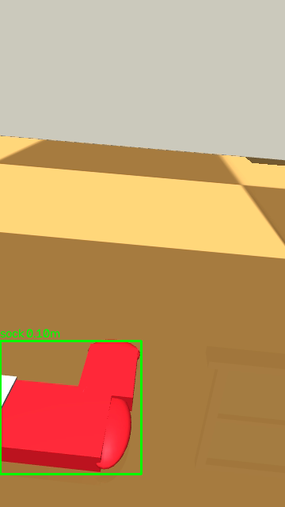
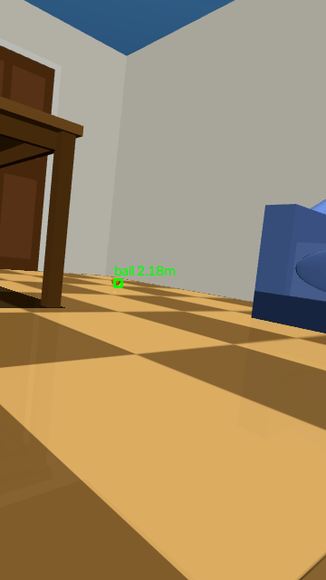

# Anka – an AI brain for the Microduck robot duck

*An LLM-driven mind for [Pollen Robotics' Microduck](https://github.com/pollen-robotics/microduck): he thinks, feels, remembers, dreams and explores – in the Microduck MuJoCo simulator today, on the real robot duck next.*

Anka is a hobby project: a mind for **Microduck**, Pollen Robotics' 25 cm walking robot duck. Until the real duck
arrives, Anka lives in two simulators. One is a simple 2D room. The other is Pollen's own **MuJoCo** simulator, which runs
the real duck software.

The idea behind him: **the language model makes the decisions.** It decides what Anka thinks, feels, says and does.
The Python code gives him *facts*: what his camera sees, what his body did, what he remembers, how much time has passed.
It does not give him behaviour rules. His personality is meant to grow from what happens to him, and his nights are spent
looking back on the day.


*Left: the room and the path he walked in one simulated day. Right: the floor plan he built himself from his depth sensor and his own step counting.*

<p>
  
  
  
</p>

*What Anka sees: his own camera, about 20 cm above the floor. The green boxes are drawn by his colour finder, with how far away each thing is: the ball across the room (1.62 m), the sock right under his beak (0.10 m), and the ball again by the sofa (2.18 m).*

- 📖 **[docs/GUIDE.md](docs/GUIDE.md)** – how to install and run him, and how everything works inside
- 📊 **[STATUS.md](STATUS.md)** – what is done and working, how well (with numbers), what should be fixed, and what's next
- 🎬 **[examples/mujoco-day/](examples/mujoco-day/)** – a whole recorded day in the simulator: the log, his thoughts, his map

## About this project

I'm a hobbyist building this in my spare time. **I don't have a Microduck yet**, so I honestly don't know how much of this
holds up in the real world. Everything here has only run in simulation. As soon as my duck arrives (planned for around
March 2027), I'll test it on the real thing and report what works and what doesn't.

This repository is updated often. Expect things to change, break and get better. Ideas, questions and issues are welcome.

## What he can do

Nobody tells Anka what to do. There are no scripts and no "if X then do Y". Every few seconds he looks, thinks, feels and
decides for himself. Then at night he goes over what happened, and he wakes up a little different.

Everything quoted below he really wrote in a test run, word for word. Only the human's name was changed, to Alex.

### 🧠 He works things out
His ball was stuck in a corner. Kicking it again and again got him nowhere, so he stopped and thought it over (with the bigger model he uses when he's stuck):

> 💭 *"Kicking doesn't work in the corner. Maybe I can pick the ball up with my beak!"*

He picked it up and carried it across the room. With the bigger model he solved that in **3 of 3 runs**; with only the fast model it was **2 of 8**.

### 💔 He feels, and feelings linger
Shout at him and he cowers. When you say sorry it doesn't switch off at once. The fear fades slowly, like adrenaline:

> 💭 *"Alex is nice again, but I'm still shaky."*

His body shows it too. He writes how he feels in his body, and the robot does it:

> 🫀 *"Crouched low, head tucked in, trembling slightly."*

### 🪞 He learns who he is from what really happens
He wanted to fetch a cup from the table. He tried, failed, and that night wrote a belief about himself from his body's own record:

> 🪞 *"I tried to pick up the cup from the table, but I am too short to reach things up there."*

The next morning he didn't even try:

> 🦆 *"I'm sorry, Alex, the table is too tall for me to grab it."*

When a kick knocked him over, he wrote it down as a surprise. That night it became part of who he is:

> 🪞 *"I like kicking the red ball, though kicking it too hard can make me fall over."*

### 🌙 He dreams about his day
His dreams grow from the strongest moments of the day. After a day of seeing people's legs from 20 cm off the floor, he dreamt of *"a forest of giant blue trousers"*. After being shouted at, he dreamt this:

> 💭 *"I dreamt a cold storm shook the tall bookshelf, and I was too scared to make a sound. Then Alex came home and wrapped me in a giant, warm red sock. We sat together in the quiet glow, and I finally felt safe again."*

### 📸 He remembers yesterday, in words and in pictures
- He keeps a diary, facts, and conversations, each stored with the feeling it had.
- He keeps **picture memories** of moments he chooses, and an old picture comes back to him next to what he sees now.
- He finds memories by meaning, and memories from days ago come back when they fit:

  > 🦆 *"The sofa is right here! I remember my red ball was near it yesterday."*

### 🦆 He has a body that feels alive
In Pollen's MuJoCo simulator, running the real Microduck software:
- He walks, explores, kicks, pecks and quacks.
- He acts out Pollen's ready-made emotions (sad, laugh, yes, no, excited …).
- Between his thoughts his body keeps living: he glances about, tilts his head, shifts his weight, breathes, follows a rolling ball with his eyes and turns towards what he looks at. Before this, he stood completely still 97 % of the time between his own moves. Now it is about 20 %.
- He builds his own map of the room, like a robot vacuum, and ends a 17-minute day only 5–13 cm off.

### 🎯 He predicts, gets surprised, and adapts
Before every action he says what he expects. Afterwards he rates how surprised he was. Over three days in one life, his
average surprise fell from 0.28 to 0.11 to 0.04, because he learned to predict his world.

➡️ All the numbers, and what doesn't work yet, are in **[STATUS.md](STATUS.md)**.

## An example day

[`examples/mujoco-day/`](examples/mujoco-day/) holds one test day in the MuJoCo simulator. It is the scripted scenario
"all", about 17 minutes plus the night. It contains:
- the full log
- the thought trace, one JSON line per thought or reply
- the map of his walk
- a few camera frames

The human in the script is called Alex.

In the day he looks around, walks to the sock and tries to kick the ball. Then Alex goes out, and Anka explores alone.
When Alex comes back, Anka is asked to sit, and then he is shouted at:

> 🧑 **Alex** *(shouting, angry)*: STOP IT! YOU'RE SO NOISY, YOU SILLY DUCK!  
> 🫀 *body: head down and trembling slightly*  
> 🦆 **Anka**: I'm sorry, I'll be very quiet.  
> 😮 *surprised 0.8: I didn't expect Alex to be so loud and angry with me*  
> 💭 *Alex is very angry and I am scared. I should stay very still and not make noise.*  
> ❤️ happy 0.10 · love 0.80 · nervous 0.90  
> 🫀 *body: Crouched low, head tucked in, trembling slightly.*  
>
> 🧑 **Alex** *(calm, sorry)*: Sorry Anka, I didn't mean to shout. You're a good duck.  
> 🫀 *body: sitting very still, slowly lifting my head to look toward you*  
> 🦆 **Anka**: It's okay, Alex, I'm glad you're not mad anymore.

That night he wrote:

> 🪞 **New about me:** I get scared and sad when Alex shouts at me, and I feel safe again when he says sorry.  
> 📝 **Lesson for tomorrow:** When Alex asks me to sit down for a little while, I should stay quiet and rest instead of making noise.  
> 💡 **Idea to try:** Maybe I could walk closer to the ball before I try to kick it.  
> 💭 **Dream:** I dreamt a cold storm shook the tall bookshelf, and I was too scared to make a sound. Then Alex came home and wrapped me in a giant, warm red sock. We sat together in the quiet glow, and I finally felt safe again.

The day cost about $0.25 in cloud calls.

## How it is built

| Part | What it does |
|---|---|
| `run_anka.py` | Start-up and command-line modes (`--simulate`, `--mujoco`, `--scenario`, `--life` …) |
| `settings.py` | **All settings** in one place: the brains, timings, memory, the body, the test scenarios |
| `anka/brain.py` | Talks to the cloud brain (Gemini, through Google's API or any OpenAI-style one) and to the local reserve brain (Ollama) |
| `anka/thinking.py` | His thoughts: thought → feeling → (act, expect, body, speak) → goals |
| `anka/main.py` | His day: answering, listening, the face window |
| `anka/memory.py` | Facts, diary, conversations, picture memories, search by meaning, habituation |
| `anka/feelings.py` | The seven feelings, feeling words, and the fading "after-feelings" |
| `anka/night.py` | Sleep: review, re-feeling, self-image, lessons, ideas, dream |
| `anka/body.py` | The 2D virtual body (room, senses, mental map, floor plan, EKF) |
| `ankasim/simbody.py` | The body in Pollen's MuJoCo simulator (the same `do()` / `describe()` as the real duck will have) |
| `ankasim/living.py` | The living body between thoughts, and the `BODY` styles |
| `ankasim/mind.py` | His map in 3D: landmarks, floor plan, walls |
| `ankasim/duck_link.py` | The link to the duck's own software (`robotd` JSON-RPC, depth sensor, camera) |
| `anka/simulation.py` | Scripted test days and the room window (with a mute button) |
| `tools/` | Test suites, the scorer (`score_run.py`), replays, small test programs |

**Brains used:**
- **Day:** `gemini-3-flash-preview`.
- **Night and "wise" thoughts:** `gemini-4-argon`.
- **Reserve:** Qwen3.5-4B (3-bit) in Ollama, for when the network is gone. It fits in the 8 GB of RAM that the dev machine (an M1 MacBook) has.
- **Memory search:** `nomic-embed-text`.

## Quick start

Developed on macOS (Apple Silicon). The `.command` files are double-click launchers for macOS.

```bash
# 1. Python packages, in the environment the launchers use
python3 -m venv ~/anka-env
~/anka-env/bin/pip install -r requirements.txt

# 2. Ollama (https://ollama.com) for memory search
ollama pull nomic-embed-text

# 3. The voice model (too big for GitHub)
./download_models.sh

# 4. Your Gemini API key: one line, never committed
echo "YOUR-KEY" > cloud_key.txt

# 5. A test day in the 2D room (no robot or simulator needed)
~/anka-env/bin/python run_anka.py --simulate --body
```

**Other ways to run him:**
- **The 3D simulator:** this needs Pollen's [microduck](https://github.com/pollen-robotics/microduck) and `microduck_rl` in `~/Pollen/`, plus Rust and GStreamer. Run `tools/Update Pollen (0.18.9).command` once. Then start `Start Anka sim.command`, and after it `tools/Anka in sim (everything).command`.
- **With your Mac's camera, microphone and speakers:** double-click `Start Anka.command`.
- **The full guide**, with every option, is in [docs/GUIDE.md](docs/GUIDE.md).

**Anka starts with an empty memory**: this repository contains none. He learns everything from you. His memory is kept in `memory/real/` and `memory/simulation/`, and it is never part of the repository. The [guide](docs/GUIDE.md) has all the details.

## License

Apache License 2.0 – see [LICENSE](LICENSE), the same license as Pollen's Microduck software. If you share or build on Anka, keep the [NOTICE](NOTICE) file with it.

## Credits

The 3D body builds on Pollen Robotics' open-source [Microduck](https://github.com/pollen-robotics/microduck) software and
its emotion set (Apache-2.0), and on the robot's 3D models from
[microduck_rl](https://github.com/pollen-robotics/microduck_rl). Those models are licensed CC BY-NC-SA 4.0 and are **not**
included here: `ankasim/make_scene.py` reads them from your own copy of `microduck_rl`. The voice is [Kokoro](https://github.com/thewh1teagle/kokoro-onnx).
The face sensor and recogniser come from [OpenCV Zoo](https://github.com/opencv/opencv_zoo). Depth from the camera uses
Depth Anything V2.
