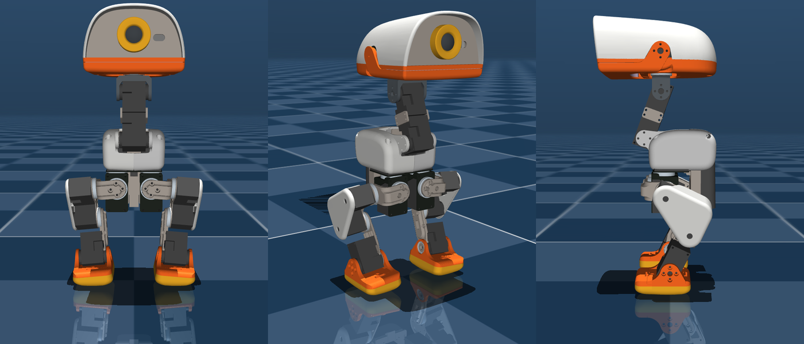
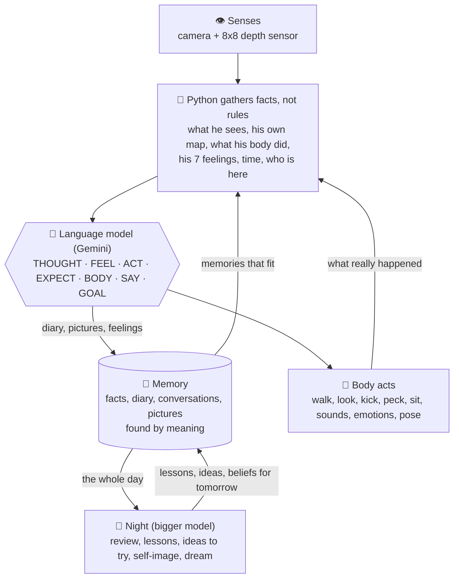

# ANKA – Microduck AI Brain

*An LLM-driven mind for [Pollen Robotics' Microduck](https://github.com/pollen-robotics/microduck): he thinks, feels, remembers, dreams and explores – in the Microduck MuJoCo simulator today, on the real robot duck next.*

*Anka* simply means **"duck"** in Swedish.

**In one sentence:** Anka is an experimental embodied AI agent that keeps autobiographical memories, reflects on his
experiences at night, thinks up ideas to try, and lets past experience shape what he does next. He is not a claim about
consciousness: everything described here is a mechanism you can read in the code and measure in the logs.

Anka is a hobby project: a mind for **Microduck**, Pollen Robotics' 25 cm walking robot duck. Until the real duck
arrives, Anka lives in two simulators. One is a simple 2D room. The other is Pollen's own **MuJoCo** simulator, which runs
the real duck software.


*The body Anka lives in: the Microduck in the MuJoCo simulator. The camera is the yellow ring in his head. Rendered
from [Pollen Robotics' 3D models](https://github.com/pollen-robotics/microduck_rl) (CC BY-NC-SA 4.0, see
[Credits](#credits)).*

The idea behind him: **the language model makes the decisions.** It decides what Anka thinks, feels, says and does.
The Python code gives him *facts*: what his camera sees, what his body did, what he remembers, how much time has passed.
It does not give him behaviour rules. His personality is meant to grow from what happens to him, and his nights are spent
looking back on the day.


*Left: the room and the path he walked in one simulated day. Right: the floor plan he built himself from his depth sensor and his own step counting.*

<p>
  
  
  
</p>

*What Anka sees: his own camera in the simulator, about 20 cm above the floor. The green boxes show what he recognised and how far away it is: the ball across the room (1.62 m), the sock right under his beak (0.10 m), and the ball again by the sofa (2.18 m). The picture itself goes to the language model too, so he describes the room in his own words.*

**How he recognises things, now and later:**
- **In the simulator (now):** a simple **colour finder**. It looks for the ball's orange and the sock's red in the picture, and works out the distance from where the thing touches the floor. It is an honest stand-in: it only works in this room, with these colours. Furniture and people come from a pretend detector that uses the simulator's own knowledge, with realistic errors added.
- **On the real duck (later):** a learned object detector, **YOLO** (`yolo11n`, plus `yoloe` for things like "sock" and "guitar"), with the distance taken from the duck's **8×8 depth sensor**. We tried YOLO in the simulator first and it recognised nothing, because the simulator's objects are simple shapes and YOLO is trained on photos. Whether it works on the real camera is one of the first things to test ([STATUS](STATUS.md#-next)).
- **Either way**, only facts reach the brain ("the ball, about 1.6 m ahead, a little to the left"). What it means, and what to do about it, is up to him.

- 🚀 **[Quick start](#quick-start)** – install and run him, or just open the **start menu** (`Anka menu.command`). You need a **Google Gemini API key** (macOS tested; Linux and Windows untested)
- 🗂️ **[Which file starts what](#which-file-starts-what)** – the launchers and folders, explained
- 📖 **[docs/GUIDE.md](docs/GUIDE.md)** – how to install and run him, and how everything works inside
- 📊 **[STATUS.md](STATUS.md)** – what is done and working, how well (with numbers), what should be fixed, and what's next
- 📓 **[docs/JOURNAL.md](docs/JOURNAL.md)** – what we tried, what worked, and what didn't (with numbers)
- 🎬 **[examples/mujoco-day/](examples/mujoco-day/)** – a whole recorded day in the simulator: the log, his thoughts, his map
- 🔒 **[Privacy](#privacy-what-leaves-your-computer)** – what is sent to the cloud, and what stays on your computer

## About this project

I'm a hobbyist building this in my spare time. **I don't have a Microduck yet**, so I honestly don't know how much of this
holds up in the real world. His body has only run in simulation; his mind has also run on my Mac with its camera,
microphone and speakers, but never inside a real robot. As soon as my duck arrives (planned for around
March 2027), I'll test it on the real thing and report what works and what doesn't.

This repository is updated often. Expect things to change, break and get better. Ideas, questions and issues are welcome.

## What he can do

Nobody tells Anka what to do. Nothing in the code scripts his behaviour, and there is no "if X then do Y". Every few seconds he looks, thinks, feels and
decides for himself. Then at night he goes over what happened, and he wakes up a little different.

Everything quoted below he really wrote in a test run, word for word. Only the human's name was changed, to Alex.

### 🧠 He works things out
His ball was stuck in a corner. Kicking it again and again got him nowhere, so he stopped and thought it over (with the bigger model he uses when he's stuck):

> 💭 *"Kicking doesn't work in the corner. Maybe I can pick the ball up with my beak!"*

He picked it up and carried it across the room. With the bigger model he solved that in **3 of 3 runs**; with only the fast model it was **2 of 8**.

### 💔 He feels, and feelings linger
Shout at him and he cowers. When you say sorry it doesn't switch off at once. The fear fades slowly, like adrenaline:

> 💭 *"Alex is nice again, but I'm still shaky."*

His body shows it too. He writes how he feels in his body, and the robot does it:

> 🫀 *"Crouched low, head tucked in, trembling slightly."*

### 🪞 He learns who he is from what really happens
He wanted to fetch a cup from the table. He tried, failed, and that night wrote a belief about himself from his body's own record:

> 🪞 *"I tried to pick up the cup from the table, but I am too short to reach things up there."*

The next morning he didn't even try:

> 🦆 *"I'm sorry, Alex, the table is too tall for me to grab it."*

When a kick knocked him over, he wrote it down as a surprise. That night it became part of who he is:

> 🪞 *"I like kicking the red ball, though kicking it too hard can make me fall over."*

### 🌙 He dreams about his day
His dreams grow from the strongest moments of the day. After a day of seeing people's legs from 20 cm off the floor, he dreamt of *"a forest of giant blue trousers"*. After being shouted at, he dreamt this:

> 💭 *"I dreamt a cold storm shook the tall bookshelf, and I was too scared to make a sound. Then Alex came home and wrapped me in a giant, warm red sock. We sat together in the quiet glow, and I finally felt safe again."*

### 📸 He remembers yesterday, in words and in pictures
- He keeps a diary, facts, and conversations, each stored with the feeling it had.
- He keeps **picture memories** of moments he chooses, and an old picture comes back to him next to what he sees now.
- He finds memories by meaning, and memories from days ago come back when they fit:

  > 🦆 *"The sofa is right here! I remember my red ball was near it yesterday."*

### 🦆 He has a body that feels alive
In Pollen's MuJoCo simulator, running the real Microduck software:
- He walks, explores, kicks, pecks and quacks.
- He acts out Pollen's ready-made emotions (sad, laugh, yes, no, excited …).
- Between his thoughts his body keeps living: he glances about, tilts his head, shifts his weight, breathes, follows a rolling ball with his eyes and turns towards what he looks at. Before this, he stood completely still 97 % of the time between his own moves. Now it is about 20 %.
- He builds his own map of the room, like a robot vacuum, and ends a 17-minute day only 5–13 cm off.

### 🎯 He predicts, gets surprised, and adapts
Before every action he says what he expects. Afterwards he rates how surprised he was. Over three days in one life, his
average surprise fell from 0.28 to 0.11 to 0.04, because he learned to predict his world.

➡️ All the numbers, and what doesn't work yet, are in **[STATUS.md](STATUS.md)**. The failures along the way are in the **[journal](docs/JOURNAL.md)**.

## An example day

[`examples/mujoco-day/`](examples/mujoco-day/) holds one test day in the MuJoCo simulator. It is the scripted scenario
"all", about 17 minutes plus the night. It contains:
- the full log
- the thought trace, one JSON line per thought or reply
- the map of his walk
- a few camera frames

The human in the script is called Alex.

In the day he looks around, walks to the sock and tries to kick the ball. Then Alex goes out, and Anka explores alone.
When Alex comes back, Anka is asked to sit, and then he is shouted at:

> 🧑 **Alex** *(shouting, angry)*: STOP IT! YOU'RE SO NOISY, YOU SILLY DUCK!  
> 🫀 *body: head down and trembling slightly*  
> 🦆 **Anka**: I'm sorry, I'll be very quiet.  
> 😮 *surprised 0.8: I didn't expect Alex to be so loud and angry with me*  
> 💭 *Alex is very angry and I am scared. I should stay very still and not make noise.*  
> ❤️ happy 0.10 · love 0.80 · nervous 0.90  
> 🫀 *body: Crouched low, head tucked in, trembling slightly.*  
>
> 🧑 **Alex** *(calm, sorry)*: Sorry Anka, I didn't mean to shout. You're a good duck.  
> 🫀 *body: sitting very still, slowly lifting my head to look toward you*  
> 🦆 **Anka**: It's okay, Alex, I'm glad you're not mad anymore.

That night he wrote:

> 🪞 **New about me:** I get scared and sad when Alex shouts at me, and I feel safe again when he says sorry.  
> 📝 **Lesson for tomorrow:** When Alex asks me to sit down for a little while, I should stay quiet and rest instead of making noise.  
> 💡 **Idea to try:** Maybe I could walk closer to the ball before I try to kick it.  
> 💭 **Dream:** I dreamt a cold storm shook the tall bookshelf, and I was too scared to make a sound. Then Alex came home and wrapped me in a giant, warm red sock. We sat together in the quiet glow, and I finally felt safe again.

The day cost about $0.25 in cloud calls.

## Real or simulated?

The same brain runs in every mode: thinking, feelings, memory and nights. Only his senses and his body change.

| | 🏠 **For real, on your computer** | 🟦 **2D simulator** | 🦆 **MuJoCo simulator** | 🤖 **The real Microduck** |
|---|---|---|---|---|
| **Status** | ✅ Works | ✅ Works | ✅ Works | ⏳ Not built yet (no duck yet) |
| **Who he meets** | You, for real | A script plays the people | A script plays the people | You, for real |
| **How he hears you** | Your microphone (press ENTER and talk) | Typed lines from the script | Typed lines from the script | The duck's microphones |
| **His eyes** | Your Mac's webcam | A drawn picture and a pretend depth sensor | A simulated camera and the 8×8 depth sensor | The real camera and depth sensor |
| **His body** | None. He sees, hears, talks and has a face on screen, but can't move | A simple 2D duck: walks, picks up, carries, kicks | Pollen's real duck software: walks, looks, kicks, pecks, sounds, emotions (no beak motor) | The real thing |
| **Recognising things** | Faces he has learned | A pretend detector | A colour finder for the ball and sock | Still to come (YOLO, faces) |
| **His memory** | `memory/real/`, his real life | `memory/simulation/` | `memory/simulation/` | `memory/real/` |
| **Start** | `Start Anka.command` | `run_anka.py --simulate --body` | `Start everything.command` | – |

**Simulations never touch his real memory.** You can test as much as you like, and the Anka you talk to at home doesn't
remember any of it.

**What the simulators can't show** (and the reason the real duck matters):
- real things in a real room, which a colour finder can't handle (in the simulator YOLO recognised nothing);
- real light, real noise and a real floor;
- real people who don't follow a script;
- falls, battery and wear on a real body.

The 3D body (`ankasim/simbody.py`) talks to the same programs the real duck runs, so it should carry over with few
changes when the duck arrives. That is still untested.

## How it is built



Every few seconds Python gathers the facts, and the language model writes one thought with its answer fields. Python
carries out the action, and what *really* happened (not what he hoped) becomes a fact for the next thought. At night a
bigger model goes over the day and writes lessons, ideas and beliefs about himself that he sees the next day.


| Part | What it does |
|---|---|
| `run_anka.py` | Start-up and command-line modes (`--simulate`, `--mujoco`, `--scenario`, `--life` …) |
| `settings.py` | **All settings** in one place: the brains, timings, memory, the body, the test scenarios |
| `anka/brain.py` | Talks to the cloud brain (Gemini, through Google's API or any OpenAI-style one) and to the local reserve brain (Ollama) |
| `anka/thinking.py` | His thoughts: thought → feeling → (act, expect, body, speak) → goals |
| `anka/main.py` | His day: answering, listening, the face window |
| `anka/memory.py` | Facts, diary, conversations, picture memories, search by meaning, habituation |
| `anka/feelings.py` | The seven feelings, feeling words, and the fading "after-feelings" |
| `anka/night.py` | Sleep: review, re-feeling, self-image, lessons, ideas, dream |
| `anka/body.py` | The 2D virtual body (room, senses, mental map, floor plan, EKF) |
| `ankasim/simbody.py` | The body in Pollen's MuJoCo simulator (the same `do()` / `describe()` as the real duck will have) |
| `ankasim/living.py` | The living body between thoughts, and the `BODY` styles |
| `ankasim/mind.py` | His map in 3D: landmarks, floor plan, walls |
| `ankasim/duck_link.py` | The link to the duck's own software (`robotd` JSON-RPC, depth sensor, camera) |
| `anka/simulation.py` | Scripted test days and the room window (with a mute button) |
| `tools/` | Test suites, the scorer (`score_run.py`), replays, small test programs |

**Brains used:**
- **Day:** `gemini-3-flash-preview`.
- **Night and "wise" thoughts:** `gemini-4-argon`.
- **Reserve:** Qwen3.5-4B (3-bit) in Ollama, for when the network is gone. It fits in the 8 GB of RAM that the dev machine (an M1 MacBook) has.
- **Memory search:** `nomic-embed-text`.

## Quick start

### What you need

- 🔑 **A Google Gemini API key.** Anka's brain runs on Google's Gemini, so he can't think properly without one. Get a key at
  [Google AI Studio](https://aistudio.google.com/apikey). A **paid key** is recommended: it costs about $0.10–0.25 per
  simulated test day, and on the free tier Google uses what you send to improve its products (see [Privacy](#privacy-what-leaves-your-computer)).
- 🐍 **Python 3.11 or newer.**
- 🦙 **[Ollama](https://ollama.com)**, free and local, for his memory search (and a much weaker reserve brain if the network is gone).
- 🦆 **For the 3D simulator only:** Pollen's Microduck software, Rust and GStreamer (macOS or Linux).

### Which computers

**Tested on macOS (Apple Silicon) only.** Linux and Windows should work for most parts, his voice included, but nobody
has tried them yet; if you do, please open an issue and say how it went. Details: [which computers](docs/GUIDE.md#which-computers).

| | macOS | Linux | Windows |
|---|---|---|---|
| Brain, memory, nights, real mode, 2D simulator | ✅ Tested | Should work | Should work |
| His voice and duck sounds | ✅ Tested | Should work (`paplay`, `aplay` or `ffplay`) | Should work (Python's `sounddevice`) |
| 3D simulator (Pollen's MuJoCo) | ✅ Tested | Should work | ❌ Not supported by Pollen's software |
| Double-click launchers (`.command`) | ✅ | Run them with `bash "<file>.command"` | ❌ Use the commands below |

### The easiest way: the start menu

```
🦆  ANKA – Microduck AI Brain

  1) Talk to Anka for real               (camera, microphone, speakers)
  2) Watch him in 2D                     (fast, no extra software)
  3) Watch him in 3D                     (Pollen's MuJoCo simulator)
  4) Teach him a face
  5) Check that everything is installed  (and fix what is missing)
  6) Connect to my Microduck             (the real robot)
  q) Quit
```

Start it with **`Anka menu.command`** (macOS, double-click), **`python3 anka_menu.py`** (Linux) or **`anka_menu.bat`**
(Windows, double-click). The first time, it offers to install everything for you: the Python packages, his voice,
Ollama's memory model and your Gemini key (you still install [Ollama](https://ollama.com) and, for 3D, Pollen's software
yourself). Option 5 checks what is there and fixes what is missing. Option 6 finds your Microduck on your wifi and tests
the connection (camera, console, SSH); starting Anka in the real body comes when the duck has arrived.

### Install and run by hand

**macOS and Linux:**

```bash
# 1. Python packages, in the environment the launchers use
python3 -m venv ~/anka-env
~/anka-env/bin/pip install -r requirements.txt

# 2. Ollama (https://ollama.com) for memory search
ollama pull nomic-embed-text

# 3. The voice model (too big for GitHub)
./download_models.sh

# 4. Your Gemini API key (get one at https://aistudio.google.com/apikey): one line, never committed
echo "YOUR-KEY" > cloud_key.txt

# 5. A test day in the 2D room (no robot or simulator needed)
~/anka-env/bin/python run_anka.py --simulate --body
```

On Linux, also install a sound player if you don't have one, for example `sudo apt install pulseaudio-utils` (for
`paplay`) or `alsa-utils` (for `aplay`).

**Windows** (PowerShell, untested):

```powershell
# 1. Python packages
py -m venv $HOME\anka-env
& $HOME\anka-env\Scripts\pip install -r requirements.txt

# 2. Ollama (https://ollama.com) for memory search
ollama pull nomic-embed-text

# 3. The voice model (too big for GitHub)
$k = "https://github.com/thewh1teagle/kokoro-onnx/releases/download/model-files-v1.0"
Invoke-WebRequest "$k/kokoro-v1.0.onnx" -OutFile kokoro-v1.0.onnx
Invoke-WebRequest "$k/voices-v1.0.bin" -OutFile voices-v1.0.bin

# 4. Your Gemini API key (get one at https://aistudio.google.com/apikey): one line, never committed
Set-Content cloud_key.txt "YOUR-KEY"

# 5. A test day in the 2D room
& $HOME\anka-env\Scripts\python run_anka.py --simulate --body
```

## Which file starts what

On a Mac you double-click the `.command` files. Elsewhere, run the command in the right-hand column with the Python
from step 1 of the quick start.

**Easiest:** the start menu, `Anka menu.command` (or `python3 anka_menu.py`, or `anka_menu.bat`). It starts everything below.

**Or start one thing directly:**

| I want to… | Double-click (macOS) | Or run |
|---|---|---|
| **Talk to Anka for real** (your camera, microphone, speakers) | `Start Anka.command` | `python run_anka.py` |
| **Watch him in the 3D simulator**, all in one go | `Start everything.command` | – (does the two steps below for you) |
| **Watch him in the 2D simulator** (no extra software needed) | – | `python run_anka.py --simulate --body` |

**The 3D simulator, step by step** (what `Start everything.command` does for you):

The 3D simulator needs Pollen's [microduck](https://github.com/pollen-robotics/microduck) and [microduck_rl](https://github.com/pollen-robotics/microduck_rl)
in `~/Pollen/`, plus Rust and GStreamer (macOS or Linux). Details in the [guide](docs/GUIDE.md#7-the-3d-simulator-in-practice).

1. `Start Anka sim.command` builds Anka's room and starts Pollen's MuJoCo simulator. **Leave that window open.**
2. Then start his brain, with one of:
   - `Anka in sim.command` – a normal test day in the simulator,
   - `tools/Anka in sim (everything).command` – the 17-minute day that tests everything (like the [example](examples/mujoco-day/)).
3. Optional: `tools/Anka eyes.command` opens a window with what the duck's camera and depth sensor see.

The first time, run `tools/Update Pollen (0.18.9).command` once. It puts your copy of Pollen's software on the version
Anka is tested with.

**Other launchers in the top folder:**

| File | What it does |
|---|---|
| `Learn a face.command` | Teaches Anka someone's face (asks for the name). Anka must be asleep, because it uses the camera. |
| `Camera floor test.command` | Tests depth from your real webcam with the laptop standing on the floor (no cloud, costs nothing). Made for the real duck later. |

**The other files and folders:**

| | What it is |
|---|---|
| `anka_menu.py` | The start menu (`Anka menu.command` and `anka_menu.bat` start it). |
| `run_anka.py` | The program every launcher starts. Its options are listed in the [guide](docs/GUIDE.md#4-the-ways-to-run-him). |
| `settings.py` | All settings in one place: brains, timings, memory, voice, the body, the test days. |
| `requirements.txt` · `download_models.sh` | What to install (quick start steps 1 and 3). |
| `anka/` | His mind: thinking, feelings, memory, nights, voice, ears, eyes, and the 2D body. |
| `ankasim/` | His body in Pollen's MuJoCo simulator: the link to the duck's software, the living body, his 3D map. |
| `tools/` | Test days, measuring, experiments and fault-finding. Every file is explained in [tools/README.md](tools/README.md). |
| `docs/` | The [guide](docs/GUIDE.md), the [journal](docs/JOURNAL.md) and images. |
| `examples/` | One recorded day in the 3D simulator. |
| `memory/` | Created when he first runs: his memory. Never part of the repository. |
| `test_logs/` | Created by test days: logs, maps and thought traces. Never part of the repository. |
| `STATUS.md` · `LICENSE` · `NOTICE` | What works now · the license · who to credit. |

**Anka starts with an empty memory**: this repository contains none. He learns everything from you. His memory is kept in `memory/real/` and `memory/simulation/`, and it is never part of the repository. The [guide](docs/GUIDE.md) has all the details.

## Privacy: what leaves your computer

Anka's cloud brain is Google's Gemini API. While he runs, these are sent to Google:
- what his **camera** sees (a small picture with each thought or answer),
- what you **say** to him (your recorded voice, so Gemini hears your words and your tone),
- the parts of his **memory** that fit the moment, his feelings and his notes, as text,
- at night, the day's memories and a few of his kept pictures, for the review and the dream.

What stays on your computer: his whole memory files, the **faces** he has learned (`known_faces.npz`), the memory search
(Ollama, local) and your API key.

**Use a paid Gemini key if this matters to you.** Google's [pricing page](https://ai.google.dev/pricing) says content
sent on the **free tier is used to improve Google's products**, and content on the paid tier is not. With `--local` he
uses only the local brain (Ollama) and nothing leaves your computer, but that brain is much weaker.

Don't point him at people who haven't agreed to it, and ask before you teach him someone's face.

## License

Apache License 2.0 – see [LICENSE](LICENSE), the same license as Pollen's Microduck software. If you share or build on Anka, keep the [NOTICE](NOTICE) file with it.

## Credits

The 3D body builds on Pollen Robotics' open-source [Microduck](https://github.com/pollen-robotics/microduck) software and
its emotion set (Apache-2.0), and on the robot's 3D models from
[microduck_rl](https://github.com/pollen-robotics/microduck_rl). Those models are licensed CC BY-NC-SA 4.0 and are **not**
included here: `ankasim/make_scene.py` reads them from your own copy of `microduck_rl`. The picture of the duck at the
top (`docs/images/microduck_sim.png`) is rendered from those models, unmodified, so that one image is under
[CC BY-NC-SA 4.0](https://creativecommons.org/licenses/by-nc-sa/4.0/), © Pollen Robotics, not Apache-2.0. The voice is [Kokoro](https://github.com/thewh1teagle/kokoro-onnx).
The face sensor and recogniser come from [OpenCV Zoo](https://github.com/opencv/opencv_zoo). Depth from the camera uses
Depth Anything V2.
